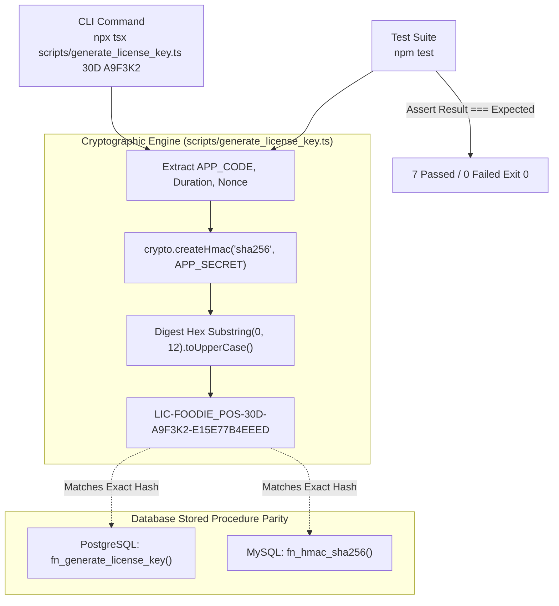

# Step 05: Automated Test Suite & Offline Cryptographic License CLI

## 🎯 Objective
Establish an automated verification test suite and interactive standalone developer CLI for the **Foodie Single-Store Configurable Food Ordering Web Application**. This phase equips developers and operations engineers with immediate, zero-dependency tools to:
1. Verify deterministic HMAC-SHA256 signature generation and tier validation rules against the PostgreSQL/MySQL database contracts.
2. Verify financial mathematics, cart subtotal sums, and promotional discount calculations without requiring external testing frameworks or heavy dependencies.
3. Provide a command-line interface (`scripts/generate_license_key.ts`) capable of generating single-tier and multi-tier cryptographic activation keys directly from local terminal sessions.

Following the engineering standards established in [`AGENTS.md`](file:///c:/Users/ADMIN/Documents/MyWork/foodie/AGENTS.md), this document details the implementation, architecture, execution semantics, and verification protocol.

---

## 💻 Terminal Commands & Command Breakdown ("What Each Command Does & Why")

### 1. Execute Automated Verification Suite
```powershell
npm test
```
- **What it does:** Runs `tsx tests/system_verification.test.ts` via the custom npm script defined in [`package.json`](file:///c:/Users/ADMIN/Documents/MyWork/foodie/package.json).
- **Why it is needed:** Validates that the Node.js runtime crypto calculations exactly mirror the deterministic HMAC-SHA256 logic inside Supabase's `fn_generate_license_key` and MySQL's `fn_hmac_sha256`, while also validating cart promotional arithmetic before deployment.

### 2. Generate Single-Tier Activation Key via CLI
```powershell
npx tsx scripts/generate_license_key.ts 30D A9F3K2
```
- **What it does:** Invokes the CLI script to compute the HMAC-SHA256 signature for the `30D` tier using current nonce `A9F3K2`.
- **Output:**
  ```text
  Generated License Key for [30D] on Nonce [A9F3K2]:
  LIC-FOODIE_POS-30D-A9F3K2-E15E77B4EEED
  ```

### 3. Generate All Activation Tiers Concurrently via CLI
```powershell
npx tsx scripts/generate_license_key.ts --all A9F3K2
```
- **What it does:** Formats and prints a structured ASCII table displaying valid cryptographic activation keys for all supported duration tiers (`7D`, `14D`, `30D`, `90D`, `264D`, `LIFE`).
- **Output:**
  ```text
  Generating all activation tiers for Nonce [A9F3K2]...

  ┌─────────┬────────┬─────────────────────────────────────────┐
  │ (index) │  Tier  │               License Key               │
  ├─────────┼────────┼─────────────────────────────────────────┤
  │    0    │  '7D'  │ 'LIC-FOODIE_POS-7D-A9F3K2-2CE194458D43'  │
  │    1    │ '14D'  │ 'LIC-FOODIE_POS-14D-A9F3K2-297DC036A810' │
  │    2    │ '30D'  │ 'LIC-FOODIE_POS-30D-A9F3K2-E15E77B4EEED' │
  │    3    │ '90D'  │ 'LIC-FOODIE_POS-90D-A9F3K2-C8EB81E15350' │
  │    4    │ '264D' │ 'LIC-FOODIE_POS-264D-A9F3K2-9DDC3EEA3644'│
  │    5    │ 'LIFE' │ 'LIC-FOODIE_POS-LIFE-A9F3K2-AB05DB3C5B78'│
  └─────────┴────────┴─────────────────────────────────────────┘
  ```

---

## 📂 Touched Files List

1. [`package.json`](file:///c:/Users/ADMIN/Documents/MyWork/foodie/package.json):
   - Registered `"test": "tsx tests/system_verification.test.ts"` in the scripts manifest.
2. [`scripts/generate_license_key.ts`](file:///c:/Users/ADMIN/Documents/MyWork/foodie/scripts/generate_license_key.ts):
   - Refactored to support both standalone CLI invocation (via Node.js process argument inspection `isDirectExecution`) and clean ES module importing without side-effect log dumps.
   - Added interactive usage banners, `--all` tier generator table, and granular error reporting.
3. [`tests/system_verification.test.ts`](file:///c:/Users/ADMIN/Documents/MyWork/foodie/tests/system_verification.test.ts):
   - Created lightweight zero-dependency test harness utilizing Node.js native `assert` module.
   - Implemented unit tests for deterministic HMAC-SHA256 computation, tier boundaries, nonce length restrictions, and cart promotional arithmetic.
4. [`docs/05_automated_testing_and_license_cli.md`](file:///c:/Users/ADMIN/Documents/MyWork/foodie/docs/05_automated_testing_and_license_cli.md):
   - This comprehensive technical manual documenting test coverage, CLI usage, and cryptographic consistency.

---

## 🏛️ Architecture & Code Walkthrough

### 1. Standalone vs. Module Execution Guard (`scripts/generate_license_key.ts`)
To allow `generateLicenseKey` to be imported cleanly by test suites without emitting interactive CLI help output or attempting to parse `process.argv` arguments, an execution boundary check was implemented:

```typescript
const isDirectExecution = process.argv[1] && process.argv[1].replace(/\\/g, '/').endsWith('scripts/generate_license_key.ts');

if (isDirectExecution) {
  const args = process.argv.slice(2);
  // Parse CLI flags and execute interactive commands
}
```

### 2. Cryptographic Algorithm Parity
The signature generation logic in TypeScript mirrors the PostgreSQL implementation (`src/db/supabase/functions_and_procedures/02_fn_generate_license_key.sql`) and MySQL implementation (`src/db/mysql/mysql_schema_and_sp.sql`):

```typescript
const rawData = `${APP_CODE}:${normDuration}:${normNonce}`;
const hmacSignature = crypto
  .createHmac('sha256', APP_SECRET)
  .update(rawData)
  .digest('hex')
  .substring(0, 12)
  .toUpperCase();

return `LIC-${APP_CODE}-${normDuration}-${normNonce}-${hmacSignature}`;
```

- **Salt / Secret:** `APP_SECRET = 'foodie_master_secret_2026_x99_secure'`
- **Payload Format:** `APP_CODE:DURATION:NONCE` (e.g. `FOODIE_POS:30D:A9F3K2`)
- **Digest Truncation:** First 12 characters in uppercase hexadecimal.

### 3. Verification Test Suite Architecture (`tests/system_verification.test.ts`)
The test runner relies on Node's native `assert` module to avoid bloated testing frameworks:
- **Test 1 & 2 (Deterministic Hashes):** Validates that `30D` with nonce `A9F3K2` produces `LIC-FOODIE_POS-30D-A9F3K2-E15E77B4EEED` and `LIFE` produces `LIC-FOODIE_POS-LIFE-A9F3K2-AB05DB3C5B78`.
- **Test 3 (Duration Tier Boundary):** Asserts that invalid durations like `999D` trigger explicit exceptions.
- **Test 4 (Nonce Length Validation):** Asserts that nonces not equal to 6 alphanumeric characters throw errors.
- **Test 5 (Subtotal Math):** Verifies floating point precision on multi-item orders.
- **Test 6 (Percentage Discount):** Verifies `FOODIE30` 30% discount logic matches cart checkout expectations.
- **Test 7 (Delivery Fee Exemption):** Verifies free delivery vouchers zero out the standard \$3.50 fee.

---

## 🔄 Data Flow (CLI & Tests -> HMAC Model -> Assertion Output)



---

## 🧪 How to Test & Verify

1. **Run the Full Test Suite:**
   ```powershell
   npm test
   ```
   **Expected Terminal Output:**
   ```text
   > foodie-ordering-system@1.0.0 test
   > tsx tests/system_verification.test.ts

   🧪 Starting Foodie POS Automated Verification Suite...

   --- 1. Cryptographic License & HMAC Signature Tests ---
     ✓ Generates deterministic HMAC-SHA256 signature for 30D tier
     ✓ Generates deterministic HMAC-SHA256 signature for LIFE tier
     ✓ Rejects invalid duration tiers
     ✓ Rejects invalid nonces not matching 6 characters

   --- 2. Order Calculations & Promo Logic Tests ---
     ✓ Calculates item subtotals correctly
     ✓ Applies FOODIE30 30% discount accurately
     ✓ Applies FREE DELIVERY discount correctly on delivery orders

   ======================================================
   Verification Suite Results: 7 Passed, 0 Failed
   ======================================================
   ```

2. **Verify Frontend & Backend Build:**
   ```powershell
   npm run build
   ```
   **Expected Terminal Output:**
   ```text
   > foodie-ordering-system@1.0.0 build
   > tsc && vite build

   ✓ built in ~2.4s
   ```
