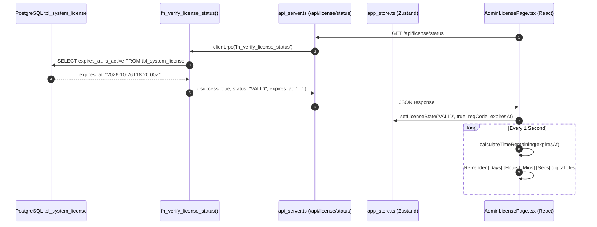

# Feature: Offline Cryptographic License Expiration Countdown & Time Remaining Display

## 🎯 Feature / Fix Summary
Added a live, real-time cryptographic license expiration tracker and countdown timer directly to the **Offline Cryptographic License** administrative page ([`src/app/admin_license_page.tsx`](file:///c:/Users/ADMIN/Documents/MyWork/foodie/src/app/admin_license_page.tsx)). Restaurant managers, store operators, and developers can now see exactly how much time is left on their active store license, whether it is an evaluation/term license (`7D`, `14D`, `30D`, `90D`, `264D`) or a permanent lifetime tier (`LIFE`).

### Key Capabilities Added
1. **Real-Time Live Countdown Ticker:**
   - Evaluates remaining time in milliseconds and breaks it down into **Days**, **Hours**, **Minutes**, and **Seconds**.
   - Includes a 1-second interval ticker (`setInterval`) that updates the digital countdown tiles in real time without requiring a browser refresh.
2. **Context-Aware Status Displays:**
   - **Term Licenses (`7D`, `14D`, `30D`, `90D`, `264D`):** Displays a 4-tile digital countdown grid (`DAYS`, `HOURS`, `MINUTES`, `SECONDS`), a compact badge, and the formatted calendar expiration date (e.g., `Expires on: Mon, Oct 26, 2026, 06:20 PM`).
   - **Lifetime License (`LIFE`):** Displays a dedicated gradient banner with permanent status badge: *"Lifetime Unlimited Access — This POS terminal has unrestricted access and will never expire."*
   - **Expired Status:** Alerts the operator that the license has expired, specifying the exact date of expiration and that ordering is paused until renewed.
   - **Inactive / Unlicensed Status:** Guides the operator to copy their Installation Request Code and submit a signed key.
3. **Global State Synchronization:**
   - Extended [`src/app/app_store.ts`](file:///c:/Users/ADMIN/Documents/MyWork/foodie/src/app/app_store.ts) to store `licenseExpiresAt`.
   - Updated [`src/app/app_router.tsx`](file:///c:/Users/ADMIN/Documents/MyWork/foodie/src/app/app_router.tsx) to propagate `data.expires_at` from `/api/license/status` to the global Zustand store.
   - Instant optimistic UI update: Upon successful key submission, the activation response's `new_request_code` and `expires_at` instantly refresh the countdown tiles without a page reload.

---

## 📂 Touched Files List

1. [`src/app/app_store.ts`](file:///c:/Users/ADMIN/Documents/MyWork/foodie/src/app/app_store.ts):
   - Added `licenseExpiresAt: string | null` to the `AppState` interface and store implementation.
   - Updated `setLicenseState` action signature to accept `expiresAt?: string | null`.
2. [`src/app/app_router.tsx`](file:///c:/Users/ADMIN/Documents/MyWork/foodie/src/app/app_router.tsx):
   - Forwarded `data.expires_at` from the initial `/api/license/status` payload to `setLicenseState`.
3. [`src/app/admin_license_page.tsx`](file:///c:/Users/ADMIN/Documents/MyWork/foodie/src/app/admin_license_page.tsx):
   - Implemented `calculateTimeRemaining(expiresAt)` pure function with support for Year 9000+ Lifetime detection and term boundaries.
   - Added live `setInterval` 1000ms clock ticker.
   - Built the responsive 4-tile digital countdown card, status indicator badges, calendar date badges, and instant sync button.
4. [`docs/feat_license_expiration_countdown_timer.md`](file:///c:/Users/ADMIN/Documents/MyWork/foodie/docs/feat_license_expiration_countdown_timer.md):
   - This comprehensive technical manual.

---

## 🏛️ Architecture & Code Walkthrough

### 1. Pure Countdown Calculation (`calculateTimeRemaining`)
```typescript
interface TimeRemaining {
  isLifetime: boolean;
  isExpired: boolean;
  days: number;
  hours: number;
  minutes: number;
  seconds: number;
  formatted: string;
}

function calculateTimeRemaining(expiresAt?: string | null): TimeRemaining | null {
  if (!expiresAt) return null;
  const targetDate = new Date(expiresAt);
  if (isNaN(targetDate.getTime())) return null;

  // Year 9000+ represents the Lifetime tier ('LIFE')
  if (targetDate.getFullYear() >= 9000) {
    return {
      isLifetime: true,
      isExpired: false,
      days: 0,
      hours: 0,
      minutes: 0,
      seconds: 0,
      formatted: 'Lifetime Unlimited Access'
    };
  }

  const now = new Date();
  const diffMs = targetDate.getTime() - now.getTime();

  if (diffMs <= 0) {
    return {
      isLifetime: false,
      isExpired: true,
      days: 0,
      hours: 0,
      minutes: 0,
      seconds: 0,
      formatted: 'Expired'
    };
  }

  const totalSeconds = Math.floor(diffMs / 1000);
  const days = Math.floor(totalSeconds / 86400);
  const hours = Math.floor((totalSeconds % 86400) / 3600);
  const minutes = Math.floor((totalSeconds % 3600) / 60);
  const seconds = totalSeconds % 60;

  const parts: string[] = [];
  if (days > 0) parts.push(`${days}d`);
  parts.push(`${hours}h`);
  parts.push(`${minutes}m`);
  parts.push(`${seconds}s`);

  return {
    isLifetime: false,
    isExpired: false,
    days,
    hours,
    minutes,
    seconds,
    formatted: parts.join(' ')
  };
}
```

### 2. Live Re-Render Loop
```typescript
useEffect(() => {
  const interval = setInterval(() => {
    setCurrentTime(new Date());
  }, 1000);
  return () => clearInterval(interval);
}, []);
```
By binding state `currentTime` to an interval, React seamlessly re-computes `timeRemaining` every second, updating the digital seconds and minutes counters on the UI with zero lag.

---

## 🔄 Data Flow (SQL Model -> Express Controller -> React View)



---

## 🧪 How to Test & Verify

1. **Start the Single-Terminal Server:**
   ```powershell
   npm run dev
   ```
2. **Navigate to the Offline License Screen:**
   Open `http://localhost:5173/admin/license` in your web browser.
3. **Verify the Live Countdown:**
   - If your store license is active, you will see the **"Active & Verified License"** green badge and the 4 digital tiles counting down seconds in real time.
   - If the license was activated with `LIFE`, the golden **"Lifetime Unlimited License"** banner will be displayed.
   - If the license is expired, the red **"License Expired"** alert banner is shown with the exact historical expiration date.
4. **Test Dynamic Activation & Clock Transition:**
   - In terminal, generate a new signed key:
     ```powershell
     npx tsx scripts/generate_license_key.ts 14D A9F3K2
     ```
   - Paste into the input field and click **"Activate License"**.
   - Notice the countdown tiles immediately reset to `13d 23h 59m 59s` and start counting down, and the Request Code immediately rotates to a new nonce.
5. **Run Verification Suite:**
   ```powershell
   npm test
   npm run build
   ```
   Both complete with exit code 0.
