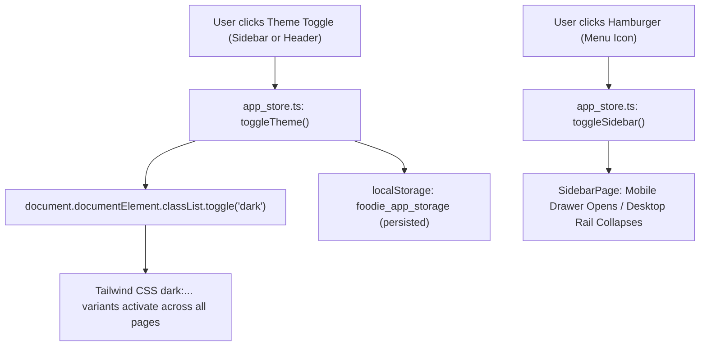

# Feature: Module Selection Sidebar & Dark/Light Theme Switcher

## 🎯 Feature / Fix Summary
Equipped the **Foodie Single-Store Configurable Food Ordering Web Application** with an interactive, responsive **Module Selection Sidebar** and a persistent **Light & Dark Theme Switcher**. 

### Key Capabilities Built
1. **Interactive Module Selection Sidebar ([`src/app/sidebar_page.tsx`](file:///c:/Users/ADMIN/Documents/MyWork/foodie/src/app/sidebar_page.tsx)):**
   - **Dual Screen Support:** Functions as a persistent, collapsible desktop sidebar on large viewports (`lg:block`, width 260px expanded, 80px collapsed rail), and transforms into a slide-over mobile drawer with backdrop blur on smaller devices (`lg:hidden`).
   - **Categorized Module Hierarchy:**
     - **Store Modules:** Home Menu (`/`), Cart & Checkout (`/cart`), Saved Favorites (`/saved`), Offers & Promos (`/offers`), Live Order Tracker (`/order/track`), Account Profile (`/profile`).
     - **Management Suite:** Kitchen Order Dashboard (`/admin/dashboard`), Food Catalog Builder (`/admin/catalog`), Store Branding Customizer (`/admin/branding`), Dynamic RBAC Matrix (`/admin/rbac`), Offline Cryptographic License (`/admin/license`).
   - **Real-Time Dynamic Badges:** Active cart item counter badge, saved items count, and live license status pills (`Active` vs. `Locked`).
   - **Active Route Highlighting:** Visual cues for the currently selected route with brand accenting.
2. **Persistent Light & Dark Theme Switcher:**
   - Enabled Tailwind CSS class-based dark mode (`darkMode: 'class'`) in [`tailwind.config.js`](file:///c:/Users/ADMIN/Documents/MyWork/foodie/tailwind.config.js).
   - Added `theme: 'light' | 'dark'` and `toggleTheme()` to the Zustand ViewModel store ([`src/app/app_store.ts`](file:///c:/Users/ADMIN/Documents/MyWork/foodie/src/app/app_store.ts)), persisted to `localStorage`.
   - Dual Theme Controls: Segmented pill selector in the Sidebar footer and an instant sun/moon toggle button in the Header ([`src/app/header_page.tsx`](file:///c:/Users/ADMIN/Documents/MyWork/foodie/src/app/header_page.tsx)).
   - Applied dark theme utility styles across background containers, borders, typography, inputs, badges, and cards.

---

## 📂 Touched Files List

1. [`tailwind.config.js`](file:///c:/Users/ADMIN/Documents/MyWork/foodie/tailwind.config.js):
   - Added `darkMode: 'class'`.
2. [`src/index.css`](file:///c:/Users/ADMIN/Documents/MyWork/foodie/src/index.css):
   - Configured `body` with `dark:bg-gray-950 dark:text-gray-100 transition-colors duration-200`.
3. [`src/app/app_store.ts`](file:///c:/Users/ADMIN/Documents/MyWork/foodie/src/app/app_store.ts):
   - Added `theme`, `setTheme`, `toggleTheme`, `isSidebarOpen`, `setSidebarOpen`, `toggleSidebar`, `isSidebarCollapsed`, and `toggleSidebarCollapsed`.
   - Added `theme` and `isSidebarCollapsed` to `partialize` for persistent storage across sessions.
4. [`src/app/sidebar_page.tsx`](file:///c:/Users/ADMIN/Documents/MyWork/foodie/src/app/sidebar_page.tsx):
   - Created full-featured flat sidebar component adhering to `AGENTS.md` naming and structure.
5. [`src/app/header_page.tsx`](file:///c:/Users/ADMIN/Documents/MyWork/foodie/src/app/header_page.tsx):
   - Added hamburger toggle button (`Menu`), quick theme toggle (`Sun`/`Moon`), and dark mode styling.
6. [`src/app/bottom_nav_page.tsx`](file:///c:/Users/ADMIN/Documents/MyWork/foodie/src/app/bottom_nav_page.tsx):
   - Added dark mode classes for mobile navigation bars.
7. [`src/app/app_router.tsx`](file:///c:/Users/ADMIN/Documents/MyWork/foodie/src/app/app_router.tsx):
   - Integrated `SidebarPage` into the global layout shell with responsive padding (`lg:pl-64` / `lg:pl-20`).
   - Added synchronization hook applying the `dark` class to `document.documentElement`.
8. [`src/app/admin_license_page.tsx`](file:///c:/Users/ADMIN/Documents/MyWork/foodie/src/app/admin_license_page.tsx):
   - Styled cards, tiles, inputs, and badges with dark mode support.
9. [`docs/feat_sidebar_module_navigation_and_theme_switcher.md`](file:///c:/Users/ADMIN/Documents/MyWork/foodie/docs/feat_sidebar_module_navigation_and_theme_switcher.md):
   - Comprehensive technical documentation.

---

## 🏛️ Architecture & Code Walkthrough

### 1. Layout Integration (`src/app/app_router.tsx`)
The application layout cleanly wraps the application shell without nested route directory bloat:

```tsx
<div className="min-h-screen flex bg-gray-50 dark:bg-gray-950 text-gray-900 dark:text-gray-100 transition-colors">
  {/* Persistent / Responsive Module Selection Sidebar */}
  {!isSplash && <SidebarPage />}

  {/* Main Layout Area */}
  <div
    className={`flex-1 flex flex-col min-w-0 transition-all duration-300 ${
      !isSplash ? (isSidebarCollapsed ? 'lg:pl-20' : 'lg:pl-64') : ''
    }`}
  >
    {!isSplash && <HeaderPage />}
    <main className="flex-1 pb-16 lg:pb-0">
      <Routes>...</Routes>
    </main>
    {!isSplash && <BottomNavPage />}
  </div>
</div>
```

### 2. Class-Based Dark Theme Synchronization
Theme updates directly mutate the `dark` class on the `document.documentElement` while preserving state in Zustand:

```typescript
setTheme: theme => {
  set({ theme });
  if (typeof document !== 'undefined') {
    if (theme === 'dark') {
      document.documentElement.classList.add('dark');
    } else {
      document.documentElement.classList.remove('dark');
    }
  }
}
```

---

## 🔄 Data Flow (Zustand ViewModel -> Sidebar & Header Views)



---

## 🧪 How to Test & Verify

1. **Start Single-Terminal Server:**
   ```powershell
   npm run dev
   ```
2. **Verify Sidebar Module Selection:**
   - On desktop, view the left sidebar displaying all store and administrative modules.
   - Click **"Kitchen Dashboard"** (`/admin/dashboard`) $\rightarrow$ verifies navigation and active link highlight.
   - Click the collapse arrow at the top right of the sidebar $\rightarrow$ verifies smooth collapse into a compact 80px icon rail.
   - On mobile/tablet viewports, verify that the hamburger icon in the header smoothly opens the off-canvas drawer.
3. **Verify Light and Dark Theme Selection:**
   - In the sidebar footer, click **"Dark"** $\rightarrow$ verifies the entire interface instantly transitions to dark mode (`dark:bg-gray-950`, dark cards, light typography).
   - In the top header, click the Sun icon $\rightarrow$ verifies instant transition back to Light mode.
   - Refresh the browser $\rightarrow$ verifies your theme choice is retained from `localStorage`.
4. **Run Verification Tests & Build:**
   ```powershell
   npm test
   npm run build
   ```
   Both complete cleanly with exit code 0.
