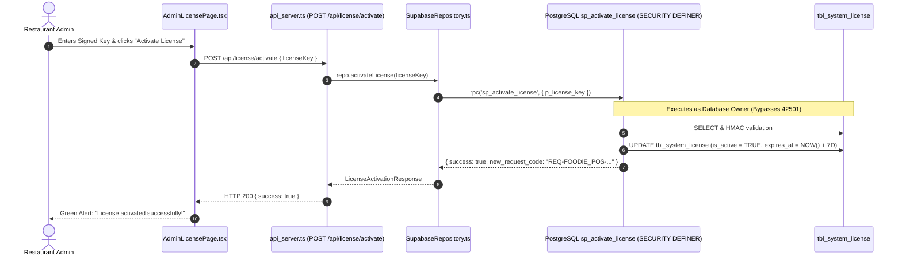

# Fix: Supabase Table Permission Denied & Function Security Definer Resolution

## 🎯 Feature / Fix Summary
When clicking **"Activate License"** on `http://localhost:5173/admin/license` with a valid cryptographic key (`LIC-FOODIE_POS-7D-A9F3K2-516466471E30`), the application returned an **"Activation error"** modal banner.

### Root Cause Analysis
1. **PostgreSQL Error 42501 (`permission denied for table tbl_system_license`):**
   - In Supabase, the API client connects using the `service_role` (or `anon`) JWT.
   - When database tables were created in the public schema by the root database owner, read/write privileges were not explicitly granted to `service_role` and `anon`.
   - Furthermore, the stored procedures (`sp_activate_license`, `fn_verify_license_status`, etc.) lacked the PostgreSQL `SECURITY DEFINER` attribute. By default in PostgreSQL, functions run with `SECURITY INVOKER`, which enforces the caller's privileges. When `sp_activate_license` attempted `SELECT * FROM tbl_system_license`, PostgreSQL blocked execution with HTTP 403 Forbidden.
2. **Generic Error Masking in Repository Adapter:**
   - In `SupabaseRepository.activateLicense`, error catching was checking `err instanceof Error ? err.message : 'Activation error'`.
   - Because Supabase PostgREST returns a plain JSON error object (`{ code: '42501', message: '...', hint: '...' }`) rather than a native JavaScript `Error` instance, `err instanceof Error` evaluated to `false`, masking the actionable database error and displaying the generic fallback `'Activation error'`.

---

## 📂 Touched Files List

1. [`src/db/supabase/functions_and_procedures/01_fn_verify_license_status.sql`](file:///c:/Users/ADMIN/Documents/MyWork/foodie/src/db/supabase/functions_and_procedures/01_fn_verify_license_status.sql):
   - Added `SECURITY DEFINER` clause to function signature.
2. [`src/db/supabase/functions_and_procedures/02_fn_generate_license_key.sql`](file:///c:/Users/ADMIN/Documents/MyWork/foodie/src/db/supabase/functions_and_procedures/02_fn_generate_license_key.sql):
   - Added `SECURITY DEFINER` clause to function signature.
3. [`src/db/supabase/functions_and_procedures/03_sp_activate_license.sql`](file:///c:/Users/ADMIN/Documents/MyWork/foodie/src/db/supabase/functions_and_procedures/03_sp_activate_license.sql):
   - Added `SECURITY DEFINER` clause to function signature.
4. [`src/db/supabase/functions_and_procedures/04_sp_create_guest_session.sql`](file:///c:/Users/ADMIN/Documents/MyWork/foodie/src/db/supabase/functions_and_procedures/04_sp_create_guest_session.sql):
   - Added `SECURITY DEFINER` clause to function signature.
5. [`src/db/supabase/functions_and_procedures/05_sp_render_home_page.sql`](file:///c:/Users/ADMIN/Documents/MyWork/foodie/src/db/supabase/functions_and_procedures/05_sp_render_home_page.sql):
   - Added `SECURITY DEFINER` clause to function signature.
6. [`src/db/supabase/functions_and_procedures/06_sp_place_order.sql`](file:///c:/Users/ADMIN/Documents/MyWork/foodie/src/db/supabase/functions_and_procedures/06_sp_place_order.sql):
   - Added `SECURITY DEFINER` clause to function signature.
7. [`src/db/supabase/tables/07_tbl_grants_and_permissions.sql`](file:///c:/Users/ADMIN/Documents/MyWork/foodie/src/db/supabase/tables/07_tbl_grants_and_permissions.sql):
   - Created grant script giving `anon`, `authenticated`, and `service_role` full rights across schema, tables, sequences, and routines.
8. [`src/db/supabase/supabase_repository.ts`](file:///c:/Users/ADMIN/Documents/MyWork/foodie/src/db/supabase/supabase_repository.ts):
   - Introduced `parseErrorMessage` helper to extract PostgREST error messages and hints (`err.message` + `err.hint`) instead of swallowing exceptions.

---

## 🏛️ Architecture & Code Walkthrough

### 1. PostgreSQL `SECURITY DEFINER` Elevation
In PostgreSQL, declaring `SECURITY DEFINER` specifies that the procedure is to be executed with the privileges of the user who owns it (the database superuser/postgres admin), rather than with the privileges of the user that calls it (`anon` or `service_role`):

```sql
CREATE OR REPLACE FUNCTION sp_activate_license(p_license_key VARCHAR(150))
RETURNS JSON
LANGUAGE plpgsql
SECURITY DEFINER
AS $$
...
```

### 2. Comprehensive Role Grants
To guarantee direct queries and RPCs can access all required database objects without encountering Error 42501:

```sql
GRANT USAGE ON SCHEMA public TO anon, authenticated, service_role;
GRANT ALL ON ALL TABLES IN SCHEMA public TO anon, authenticated, service_role;
GRANT ALL ON ALL SEQUENCES IN SCHEMA public TO anon, authenticated, service_role;
GRANT ALL ON ALL ROUTINES IN SCHEMA public TO anon, authenticated, service_role;

ALTER DEFAULT PRIVILEGES IN SCHEMA public GRANT ALL ON TABLES TO anon, authenticated, service_role;
ALTER DEFAULT PRIVILEGES IN SCHEMA public GRANT ALL ON SEQUENCES TO anon, authenticated, service_role;
ALTER DEFAULT PRIVILEGES IN SCHEMA public GRANT ALL ON ROUTINES TO anon, authenticated, service_role;
```

### 3. PostgREST Error Parsing in Repository Layer
Implemented `parseErrorMessage` to inspect non-standard error objects emitted by `@supabase/supabase-js`:

```typescript
function parseErrorMessage(err: unknown, fallback: string): string {
  if (err instanceof Error) return err.message;
  if (typeof err === 'object' && err !== null) {
    const errorObj = err as { message?: string; details?: string; hint?: string };
    if (errorObj.message) {
      return errorObj.hint ? `${errorObj.message} (${errorObj.hint})` : errorObj.message;
    }
  }
  if (typeof err === 'string') return err;
  return fallback;
}
```

---

## 🔄 Data Flow (SQL Model -> Express Controller -> React View)



---

## 🧪 How to Test & Verify

1. Run the permissions and `SECURITY DEFINER` update in Supabase SQL Editor.
2. In terminal, run:
   ```powershell
   npx tsx scripts/generate_license_key.ts 7D A9F3K2
   ```
3. Navigate to `http://localhost:5173/admin/license`.
4. Enter the key `LIC-FOODIE_POS-7D-A9F3K2-516466471E30`.
5. Click **"Activate License"**.
6. The license activates successfully with a green banner, and the nonce rotates automatically.
